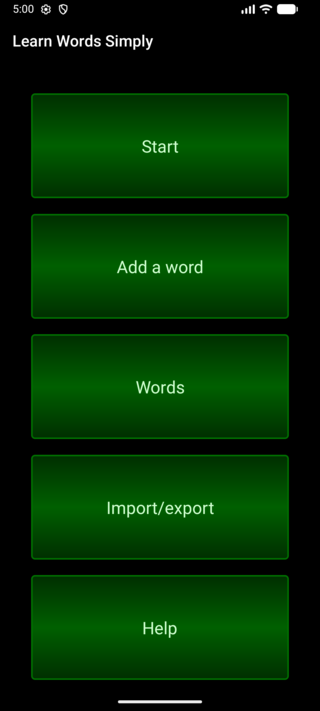
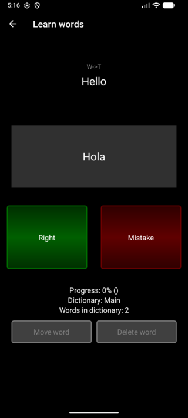

# Learn Words Simply

A small Android app for learning foreign words — the ones you actually
run into.

## The idea

You are reading a book or watching a movie and keep meeting words you
don't know. Write down a small portion of them, 5–15 at a time, and add
them to the app. They go to the **main dictionary**: the words you are
learning right now, over the next day or two.

It works like the well-known paper cards: a word on one side, its
translation on the other, a stack of them in your pocket to flip through
on the way somewhere. The app shows you one side, you recall the other,
look at the answer and honestly mark whether you got it right. Just like
a card, a word can come up from either side — sometimes you see the word
and recall the translation, sometimes the other way round. Once you
answer a word correctly several times in a row both ways, the app offers
to move it to the **repeat dictionary**.

The repeat dictionary holds the words you already know. From time to time
they come back to refresh your memory. If it turns out you have forgotten
a word, send it back to the main dictionary and learn it again. And when
you know a word so well that seeing it again is a waste of time, delete
it for good.

You can study only new words, only repeat old ones, or mix them: mostly
new words with an old one now and then.

## Screenshots

<p>
  
  &nbsp;
  
</p>

The main screen leads to the dictionaries and training modes; on the
training screen you see one side of a card, recall the other, reveal the
answer and mark whether you got it right.

## Development

Requires Node 22.18 or newer (the tests run TypeScript directly).

```bash
npm install
npx expo start      # dev server
npm test            # unit tests
npx tsc --noEmit    # typecheck
npx expo lint       # lint
```

Run `npx expo start` once before the first typecheck — it generates the
route types `tsc` needs.

The learning logic is plain TypeScript in `src/core`, the screens are in
`src/app`, and `src/storage` is the only part that talks to the device's
file system.

## License

This project is licensed under the [MIT License](LICENSE).
